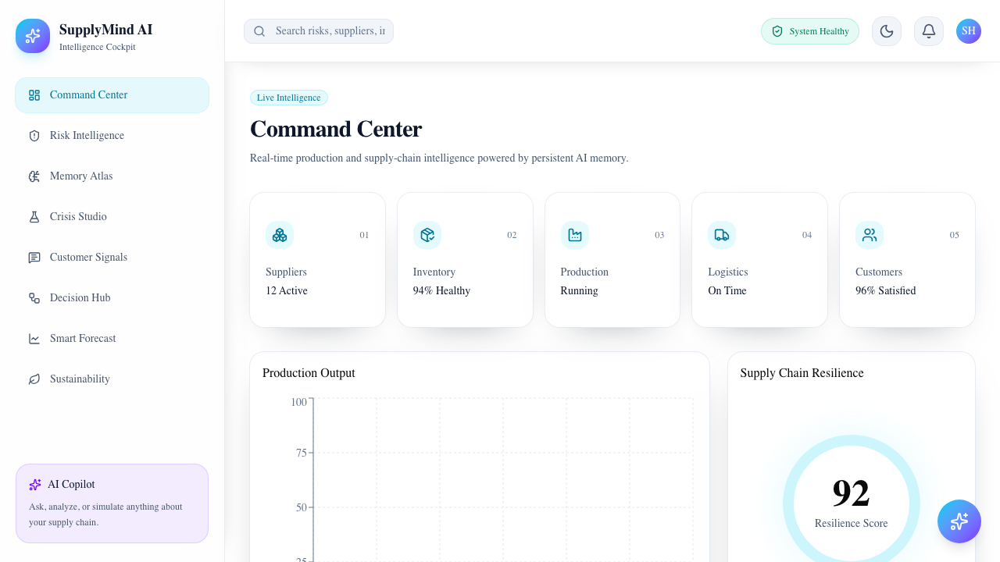
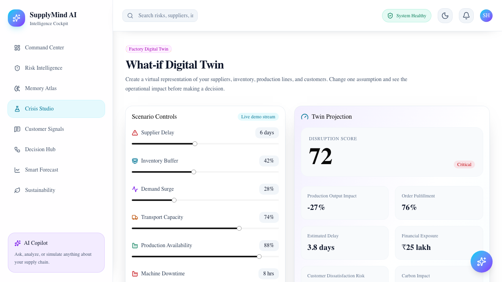

# SupplyMind AI

> **A living supply-chain intelligence cockpit that predicts disruption, explains the decision, learns from the outcome, and improves over time.**

SupplyMind AI is a responsive supply-chain intelligence cockpit for teams that need to understand operational risk before it becomes a production or customer problem. It is designed as a closed learning cycle—not a one-time prediction.

The product combines risk monitoring, demand forecasting, organizational memory, customer signals, sustainability analysis, and a what-if factory Digital Twin in one friendly dashboard.

## Product story

```text
Live risk signal → Prediction → Recommendation → Human decision
      → Actual outcome → Hindsight evaluation → Confidence update
      → Memory saved → Better recommendation next time
```

Example: Supplier A may delay Component X by six days. SupplyMind recommends shifting 35% of demand to Supplier B. After the event, the operator records the actual delay and recovery time. Hindsight stores the result, so a future incident can reuse the evidence instead of starting from zero.

## See the product

### Command Center

The Command Center gives an at-a-glance view of suppliers, inventory, production, logistics, customers, and resilience.



### What-if Digital Twin

Crisis Studio is the Digital Twin workspace. Move the scenario sliders and the projected disruption, fulfillment, delay, exposure, and sustainability metrics recalculate immediately.



## What the app includes

- **Command Center** — high-level production, inventory, logistics, customer, and resilience health.
- **Risk Intelligence** — prioritized supplier, inventory, production, and logistics risks.
- **Memory Atlas** — searchable organizational memory for incidents, decisions, and outcomes.
- **Crisis Studio / What-if Digital Twin** — change supplier delay, inventory buffer, demand, transport, production, and machine downtime to see projected impact.
- **Customer Signals** — connect service complaints and sentiment to operational risks.
- **Decision Hub** — review recommendations, approve or reject actions, and inspect decision history.
- **Smart Forecast** — explore demand trends and stockout countdowns.
- **Sustainability** — compare sourcing decisions by cost, distance, emissions, and efficiency.
- **Responsive themes** — light and dark themes with a persistent theme toggle in the top bar.
- **Supply Chain Network** — a live star-topology view of suppliers, factory, logistics, and customers, with delay-risk signals and notifications.
- **Closed-loop learning** — prediction-versus-actual evaluation, confidence updates, counterfactual comparison, and human feedback.

## Judge-ready demo flow

1. Open **Supply Chain Network** and show Supplier A's live delay-risk signal.
2. Open **Crisis Studio** and change supplier delay or demand surge.
3. Open **Decision Hub** and approve, reject, or simulate the proposed recovery.
4. Enter the actual delay, production loss, and recovery time under **Hindsight Update**.
5. Show prediction accuracy and confidence changing immediately.
6. Open **Memory Atlas** and show the saved experience recalled by Hindsight.

This demonstrates innovation, technical implementation, user experience, real-world impact, and the full Hindsight learning loop in one coherent story.

## Run locally

Requirements: Node.js 20+ and npm.

```bash
git clone https://github.com/SRIHARSHA2108/supplymind-ai.git
cd supplymind-ai
npm install
npm run dev
```

Open [http://localhost:3000](http://localhost:3000).

Useful checks:

```bash
npm run lint
npm run build
```

## Environment variables

Copy the example file and add your Supabase project values locally:

```bash
cp .env.example .env.local
```

```text
NEXT_PUBLIC_SUPABASE_URL=your_supabase_project_url
NEXT_PUBLIC_SUPABASE_PUBLISHABLE_KEY=your_supabase_publishable_key
HINDSIGHT_API_KEY=your_hindsight_api_key
HINDSIGHT_BANK_ID=supplymind-operations
HINDSIGHT_BASE_URL=https://api.hindsight.vectorize.io
```

The app remains usable with local sample/simulation behavior when Supabase is not configured.

### Hindsight memory loop

Memory Atlas calls Hindsight's server-side `recall` operation to retrieve prior supplier delays, inventory shortages, and recovery outcomes. Operational events can be stored with `retain`, then the current scenario recalls relevant experiences before a decision is made. The browser never receives the Hindsight key.

The production Vercel environment is wired to Hindsight. Hindsight Cloud requires an available credit balance to process hosted API requests; when the balance is empty, the app reports the service state instead of pretending that live memory was retrieved. For a zero-cost setup, use the built-in demo/fallback mode or run Hindsight locally with a local model.

## How real-time updates work

There are two clearly different modes:

### 1. Live demo stream

If no live database is configured, Crisis Studio runs a built-in five-second stream so the interface can be demonstrated immediately. The badge says **Live demo stream**. These values are generated by the browser and are not factory data.

### 2. Live feed connected

For genuine shared real-time data, an ERP, IoT service, or operator system writes the current factory state to Supabase. Supabase Realtime broadcasts the database event to every open Crisis Studio session.

```text
ERP / IoT / operator update
          ↓
Supabase factory_state row
          ↓  Realtime event
Next.js Crisis Studio client
          ↓
Digital Twin metrics recalculate without refresh
```

When this is working, the Scenario Controls badge changes to **Live feed connected** and the Twin Snapshot shows an updated timestamp.

## Set up genuine real-time data

Crisis Studio can subscribe to a Supabase Realtime table named `factory_state`. To create the table and enable its Realtime publication, run [`supabase/factory-state.sql`](supabase/factory-state.sql) in the Supabase SQL Editor.

The expected row is `id = 'current'` with these fields:

```text
supplier_delay
inventory_buffer
demand_surge
transport_capacity
production_availability
machine_downtime
updated_at
```

Your ERP, IoT service, or operations tool can update that row. Connected Crisis Studio sessions will receive the new state without a page refresh.

### Verify it step by step

1. Open `/crisis` in one browser tab.
2. Confirm the badge says **Live feed connected**.
3. In Supabase SQL Editor, run:

   ```sql
   update public.factory_state
   set
     machine_downtime = 36,
     demand_surge = 50,
     updated_at = now()
   where id = 'current';
   ```

4. Watch the open Crisis Studio tab. The slider values, Twin Snapshot, runway, production output, and fulfillment should change without a page refresh.

If the badge says **Live demo stream**, the Supabase table or environment variables are not connected yet. That mode is intentional and keeps the demo usable while the live source is being configured.

## Technology and architecture

- **Next.js 16 + React 19 + TypeScript** — responsive application and server routes
- **Tailwind CSS** — accessible responsive design system and themes
- **Supabase** — factory-state persistence and Realtime broadcasts
- **Hindsight Cloud** — retain, recall, and long-term operational memory
- **Vercel** — production hosting and deployments
- **Recharts + Lucide React** — operational visualizations and consistent icons

### Runtime architecture

```text
┌──────────────────────┐      update       ┌────────────────────────┐
│ ERP / IoT / Operator │ ────────────────→ │ Supabase factory_state │
└──────────────────────┘                  └───────────┬────────────┘
                                                      │ Realtime event
                                  ┌───────────────────┼───────────────────┐
                                  ↓                   ↓                   ↓
                         ┌────────────────┐  ┌────────────────┐  ┌──────────────┐
                         │ Crisis Studio │  │ Supply Network │  │ Notifications│
                         │ Digital Twin  │  │ live topology  │  │ delay alerts │
                         └───────┬────────┘  └────────────────┘  └──────────────┘
                                 │ prediction + human decision
                                 ↓
                         ┌────────────────┐
                         │ Decision Hub   │
                         │ actual outcome │
                         └───────┬────────┘
                                 │ retain / recall
                                 ↓
                         ┌────────────────┐
                         │ Hindsight      │
                         │ memory engine  │
                         └────────────────┘
```

### What is real time?

| Flow | Live behavior |
| --- | --- |
| Factory state | Supabase Realtime broadcasts updates without refresh |
| Network topology | Supplier delay, capacity, production, and demand signals update live |
| Notifications | Delay-risk alerts are generated from incoming factory-state events |
| Hindsight memory | Retain and recall requests complete immediately when an operator saves or searches |
| Digital Twin | Scenario sliders recalculate impact immediately in the browser |

The app labels the source honestly: **Live feed connected** means Supabase is receiving shared state; **Live demo stream** means local generated values are being used for demonstration.

```text
ERP / IoT / operator event
          ↓
Supabase factory_state ── Realtime ──→ Crisis Studio + Network + Notifications
          ↓
Decision Hub prediction → human decision → actual outcome
          ↓
Hindsight retain → recall similar experiences → improve next decision
```

## Project structure

```text
app/                     Next.js routes and dashboard pages
components/              Shared layout, theme, and UI components
lib/supabase/             Supabase browser client
supabase/                 Database and Realtime setup SQL
public/                   Static assets and README screenshots
```

## Deployment

The project is configured for Vercel:

```bash
npx vercel --prod
```

For a production deployment, add the Supabase environment variables in **Vercel → Project Settings → Environment Variables**, select **Production**, save, and redeploy.

## Design direction

SupplyMind uses a calm light canvas with cyan and violet intelligence accents. Cards, badges, and charts use color to communicate status—not decoration alone. The theme toggle provides a dark workspace for low-light operations while preserving the same visual hierarchy and contrast.
